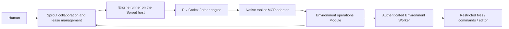

# Host-run engines with remote Environment tools

## Status and conclusion

Research and an implementation proposal, not an accepted ADR or implemented behavior. This note evaluates moving engine processes onto the Sprout host while retaining remote Environment instances for working files, commands, editors, and other scarce capabilities.

The topology is feasible. Pi supplies an official SSH example that keeps the engine local and delegates `read`, `write`, `edit`, and `bash` operations to another machine. OpenCode documents custom tools that can override built-in tool names. Claude Code supports MCP tools and removing built-in work tools. Codex supports MCP and documents experimental app-server client-executed dynamic tools. These are different integration surfaces; none establishes complete, secure remote execution for every engine without additional work. [S1–S7]

Recommended direction: host-run engines, an engine-neutral Environment operations Module, and enrolled remote Workers that enforce execution restrictions. Treat Pi, Codex, and Claude Code as required feasibility candidates. The Pi protocol probe is an initial proof, not the acceptance scope. [The Codex/Claude follow-up](codex-claude-host-run-remote-work-compatibility.md) verifies Claude's tool-exclusion interfaces and an installed Codex native-executor candidate. Use MCP as a common adapter where appropriate, while preserving engine-native remote execution when it meets the same authority contract.

The main benefit is less repeated installation and model-account authentication on development machines. The main engineering cost is replacing the assumptions that an engine's native filesystem, shell, session store, and work Environment all occupy the same host.

## Repository evidence

Current execution and Environment selection are coupled:

- [ADR-0003](../adr/0003-each-environment-runs-a-sprout-worker.md) requires the selected Environment's Worker to host the engine process. It explicitly rejected a core-side supervisor containing platform-specific remote launch knowledge.
- [ADR-0012](../adr/0012-production-workers-use-enrollment-backed-outbound-connections.md) retains that execution decision while replacing production carriers with enrollment-backed outbound Worker connections and connection epochs.
- [ADR-0004](../adr/0004-engine-session-keys-are-scoped-to-one-environment-slot.md) keys native continuation by Agent, engine, Environment instance, and working directory because native state lives at that execution location.
- [ADR-0005](../adr/0005-task-held-environment-lease.md) binds a begun Task to one Environment and retains its lease across runs, pause, blockers, validation, and recovery.
- [The roadmap](../roadmap.md) requires Human authorization of Task begin, keeps active Tasks on one Environment, and keeps engine credentials on the host where the harness runs. Credentials need not enter the Sprout database under the proposed topology.
- [`src/run/orchestrator.ts`](../../src/run/orchestrator.ts), especially `#execute`, resolves adapters for `environmentInstanceId`, acquires or validates the Environment lease, and uses the same instance in session-key identity.
- [`src/worker/protocol.ts`](../../src/worker/protocol.ts) mainly exposes engine session/turn operations plus workspace/context and recovery operations. It does not yet provide a general remote file/command operation protocol.
- [`src/engine/port.ts`](../../src/engine/port.ts) exposes model/effort, instructions, working directory, and continuation. Tool injection and tool-routing guarantees are not declared capabilities of the current Interface.
- [`src/engine/pi.ts`](../../src/engine/pi.ts) launches Pi in the selected working directory. [`src/engine/codex.ts`](../../src/engine/codex.ts) starts or resumes a Codex thread with that directory and a sandbox policy; it does not yet register dynamic tools or handle their execution requests.
- [`src/worker/recovery-journal.ts`](../../src/worker/recovery-journal.ts) already demonstrates durable recovery and the distinction between process loss and proof that execution has stopped. That distinction must extend to remote command processes.

Lease allocation is already centralized in Sprout. The change relocates engines and changes how Environment capabilities are consumed; centralization alone is not a new benefit.

The proposal contradicts ADR-0003's engine placement and requires reconsidering ADR-0004's native continuation identity. ADR-0012's enrollment/authentication/epoch protections and ADR-0005's Task ownership protections remain useful and should be preserved. A change to Task begin or Task movement would be a separate product decision, not an incidental consequence of tool routing.

## Engine integration evidence

| Engine | Verified extension route | What is established | What still needs a Sprout prototype |
| --- | --- | --- | --- |
| Pi | Extension tools and pluggable tool operations | Official `ssh.ts` delegates read/write/edit/bash to SSH; extension events and active-tool selection allow controlling tool behavior. | Installed-version compatibility; all enabled tools and nested execution paths covered; remote restrictions and cancellation proof. |
| OpenCode | TypeScript custom tools and plugins; MCP also available | Official docs explicitly say a custom tool with a built-in tool's name takes precedence, including a `bash` example. | Cover the full work tool set and relevant plugin/permission behavior in Sprout's existing adapter. |
| Claude Code | MCP tools; CLI control of built-in tools; Agent SDK custom tools | CLI `--tools` controls built-in tools independently of MCP. SDK custom tools can run as in-process MCP servers. | A Sprout engine adapter and observable, restricted remote work behavior. SDK integration is distinct from wrapping the CLI. |
| Codex | MCP; experimental app-server dynamic tools | `dynamicTools` on `thread/start` and `item/tool/call` delegate custom tool execution to the client; experimental opt-in is required. | Installed-version protocol; native local tool restrictions, including file mutations; dynamic-tool resume behavior; MCP versus dynamic-tool adapter choice. |
| Gemini CLI | Extension-packaged MCP | Official extension documentation exposes MCP server configuration. | Broader compatibility candidate, not acceptance evidence for Sprout or an assurance of complete tool replacement. |
| Other engines | Possibly MCP or an existing restricted tool interface | A compatible external-tool route can supply remote operations. | Classify individually. If unrestricted local tools cannot be removed or confined, do not claim a controlled host-run mode. |

A plugin package is not necessarily an alternative execution protocol to MCP. Claude's in-process custom tools are still MCP tools. Codex's dynamic tool path is an experimental client callback mechanism, not evidence that all built-in tools can be replaced by a plugin. [S3–S7]

Official documentation and upstream main branches can advance ahead of installed releases. These findings establish architectural feasibility, not a tested minimum version matrix. Pin engine versions and probe adapter capabilities before accepting real work.

Pi's SSH example is useful design evidence, not a production access-control implementation. It maps paths with string replacement, launches SSH for individual operations, uses shell command interpolation, and kills the local SSH child on cancellation. Those details do not prove path confinement, safe quoting, or that remote descendants have stopped. Do not copy it as the execution security mechanism. [S1]

## Proposed topology

The diagram describes logical Modules, not a requirement to add separate network services. The runner can be a separately supervised process on the same physical host. Platform-specific execution belongs behind the Worker Interface, outside the core collaboration logic.

The engine host holds engine installations, model-account authentication profiles, engine-native session storage, and controlled local session directories. Remote Environments hold Project workspaces, build dependencies, editor state, caches, and Task context directories. Model-account credentials stay in the engine's private authentication store on the runner host, not in portable Agent configuration or remote tools.

Remote development credentials may still be needed for Git, registries, signing, or other work. Removing model-engine logins does not remove those dependencies. Local login once also means once per necessary authentication profile, not one shared identity for every future Team or Human.

A remote Worker remains valuable even though it no longer needs an engine installation in this mode. It authenticates the Environment, resolves opaque workspace identities, enforces operation grants, supervises processes, supplies results, and proves recovery state. Production access should reuse the enrolled outbound connection rather than requiring the Agent to possess broad SSH credentials.

### Conversation and Environment access

An ordinary Agent run can start on a ready engine host with a controlled local session directory and no work Environment binding. It can answer from its supplied context without invoking a remote operation. This does not require stopping Environment heartbeats or existing Worker connections.

Remote operations are admitted only under the Project's Environment access and the Human-authorized work scope:

- A conversation with no remote work uses no work Environment lease.
- Read-only investigation may use an explicitly permitted non-lease capability. Current definitions already distinguish `read-only-investigation`; remote reads still require access checks and disclosure controls.
- A Human-approved Task continues to select one Environment at Task begin and holds its Task lease until Task end. Nested Agent runs reuse that lease.
- One-round work may acquire a run-held lease when its first lease-requiring operation is requested, within an already authorized scope, and retain it through the operation sequence and verified settlement.
- Lease conflict returns an observable unavailable/blocked outcome. It must not silently send a command to another Environment or create a durable Task without Human authorization.

Lazy acquisition is appropriate for one-round work; releasing the lease after every individual tool call is not. Multiple file edits, tests, and editor operations depend on a stable working state across calls. A stopped engine also does not prove that remote work has stopped.

The first implementation can reserve an Environment before a work run while still allowing separate lease-free conversational runs. Lazy admission mid-turn should follow once the admission and recovery behavior is proven. This avoids making every feasibility question depend on a new Task lifecycle.

### The Environment operations Interface

Use a small engine-neutral external Interface, tentatively:

- `execute(binding, operation)` starts a typed file, command, or editor operation and returns an operation identity plus bounded/streamed results.
- `inspect(operationId)` returns durable state, including an unknown outcome when evidence is insufficient.
- `cancel(operationId)` requests cancellation and returns whether termination is proven or still pending.

Names are illustrative. The binding is authority supplied by the runner/core, not arbitrary Agent-authored network addresses or lease claims. Engine adapters only translate tool calls/results. The Implementation hides Worker routing, authorization, lease validation, connection epochs, result limits, durable operation records, and recovery.

An arbitrary command must be explicitly classified and authorized as command execution; a model-supplied `readOnly` flag cannot make shell execution a read-only capability. More specialized capability types should be added when a real editor or test runner needs them.

The first real adapters can be Pi native tools and a local MCP facade used by Codex. They should cross the same operations Interface and produce the same authority and operation records. A generic Sprout plugin framework is not a prerequisite.

### MCP configured by a remote Project

A remote Project's MCP configuration is an additional capability source. Replacing filesystem and command tools does not cause a host-run engine to discover or load the remote Project's MCP configuration automatically. The supported configuration formats and lifecycle behavior must be explicit per engine adapter.

There are two primary cases:

- **HTTP MCP endpoint:** the server already runs somewhere reachable. The host-run engine may connect directly if that network route and independent authorization are appropriate. If tools operate on a leased Environment or Sprout must enforce Project-scoped grants, access should go through a controlled proxy or equivalent enforcement at the server. A remote `localhost` URL identifies the remote machine, not the runner; preserve that origin by using the Worker connection or a restricted tunnel.
- **stdio MCP server:** the configuration describes a command, arguments, working directory, and possibly environment variables. MCP stdio normally launches a server subprocess on the client host. Executing the same configuration on the runner can use the wrong filesystem, dependencies, credentials, and editor connection. Instead, the remote Worker starts and supervises that MCP subprocess in the authorized Project workspace and bridges its protocol connection back to the engine. The MCP transport specification describes subprocess stdio and HTTP as different standard transports. [S10]

The Agent can see the remote server's typed tools as ordinary tools. It need not call a generic `sprout.call_mcp(server, tool, arbitrary_json)` tool or choose a second tool through another model turn. A bridge can carry MCP messages over the existing authenticated Worker transport. An MCP proxy may also act as a server toward the engine and a client toward the remote server. This is two protocol connections with forwarding, not inherently a second Agent or inference loop.

Prefer registering separate remote MCP servers with the host engine, using stable server identities, over flattening every server into one large aggregate catalog. A proxy still needs correctly scoped sessions, request identifiers, cancellation, notifications, and any supported resources/prompts or server-to-client requests; forwarding only `tools/call` is not a complete transparent MCP implementation. If the first slice supports only tools, advertise that limit explicitly. Engine hot attachment and catalog refresh are adapter capabilities to verify; a new session may be required.

Treat configuration as proposed execution, not authority. A repository change must not silently run arbitrary commands on the runner or grant remote capabilities. Resolve paths and secret references on their origin host; do not copy remote credentials into portable Agent configuration or the Sprout database. Existing engine-specific approval/trust behavior needs an explicit equivalent when Sprout becomes the loader.

Lease requirements depend on capabilities and process lifetime, not on the MCP label. A shared external issue-tracker MCP may require no Environment lease; a remote editor MCP that mutates a Project workspace does. A `readOnlyHint` or other tool annotation is descriptive metadata, not proof that a tool is safe or lease-free. A server may perform work during startup or retain state after a call, so authorization and, when needed, leasing must happen before server startup/attachment, not necessarily only on the first tool invocation. Tool discovery may itself require starting the server; it cannot always be promised as a no-connection operation.

On Task end, revocation, or binding changes, stop admitting calls and reconcile Environment-scoped MCP processes and ongoing operations before release. A disconnected proxy does not prove the MCP server stopped. Ordinary chat can remain independent by not attaching these Environment-scoped MCP connections until a permitted work scope is selected.

Add a prototype check with a Project-configured stdio MCP that reads remote files or talks to a remote editor: the server must run only on the remote host, the engine must see its original typed tools, cross-Project access must be denied, and disconnect/cancellation must not silently release a still-active Environment. Also test a remote-loopback HTTP endpoint and explicitly record unsupported protocol features.

### Discovering MCP after connection and switching bindings

Tool availability and model-visible context are separate state. A prompt that mentions a tool cannot register it; registering a tool alone does not explain that previous workspace facts are now stale. Use both a current tool catalog and an explicit environment-change context record.

Discovery flow:

1. Start a conversational session with only the permitted host capabilities. It does not need to know the future remote catalog.
2. Once an authorized Project workspace and Environment binding are selected, the Worker inspects supported configuration files and returns sanitized server descriptors. Descriptors are not proof that servers are running or tools are ready.
3. Start or connect the permitted servers on their origin host. Run MCP initialization and `tools/list` to obtain actual tool names, descriptions, and schemas. Server startup may require the lease before discovery.
4. Stage the engine's tool registrations, apply the allowed subset, then publish a versioned ready binding. Tell the model the current Environment/workspace, important capabilities, unavailable capabilities, and binding revision. Do not paste every tool schema into conversation text; the engine supplies tool declarations through its normal tool mechanism.
5. Preserve catalog and binding facts in Sprout's authoritative state. MCP `notifications/tools/list_changed`, when advertised by the server, signals that the client should refresh the tool list. It does not itself guarantee that the embedding engine updates its model tool loadout. [S8]

Use a stable tool naming/mapping policy that includes server identity and prevents silent retargeting. Every dispatched call retains its original binding generation, even if a new server exposes the same logical tool name. Calls issued under A must never execute on B merely because an alias now points there. Include origin Environment/workspace/revision in operation results and durable records.

Switch flow:

1. Stop admitting work calls against the old binding and fence its authority.
2. At a model-request boundary, finish or explicitly cancel and reconcile in-flight operations. A request to switch does not prove remote processes stopped. Do not expose a partly changed catalog during a parallel tool batch.
3. Withdraw old Environment-scoped tools/connections; stage discovery and authorization for the new Environment. On failure, publish a detached/unavailable state rather than claiming a successful switch or silently restoring old grants.
4. Commit the new binding generation and usable catalog. Append a short structured context record containing old/new Environment, current workspace, removed/added capabilities, and which earlier observations must be rechecked.
5. Continue with the provider-compatible tool declaration update. Keep historical work as history with its origin; rebuild a compact current binding snapshot for subsequent activations and compaction so an old event cannot become the current truth.

A current snapshot might say: `Binding revision 2; Environment B; workspace project-demo; available editor.read_scene and editor.run_tests; Environment A is detached. Paths, build outcomes, and editor state observed on A are historical and must be rechecked on B.` This is a Sprout-produced context fact, not a Human-authored message or new permission grant. Capability descriptions and remote server instructions remain untrusted remote content and must not rewrite Sprout's authority policy.

Keep standing policy in the system prompt. Update actual tool registrations, let the engine project the current tool declarations, and append a bounded context event at the next safe model request. A provider or engine may internally rebuild its leading prompt or transcript checkpoint; Sprout should use that supported behavior rather than manually editing persisted provider messages. Pi documents that prompt/tool changes are appended before the next request, with a transcript checkpoint fallback for providers that cannot represent the transition; that fallback can invalidate prompt cache. [S2]

Repeated switches should not append full catalogs indefinitely. Durable history retains change events, while model context gets the current snapshot plus only recent relevant change facts. Histories must remain scoped to permitted Project/conversation/Task identities; moving an Agent does not authorize merging unrelated native conversations.

Engine capability handling:

- **Pi:** current extension documentation provides `registerMcpServer`, `unregisterMcpServer`, and active-tool updates. A local installed-SDK probe below verifies registration and withdrawal in one session. The engine applies model-facing tool changes before a subsequent request. [S2]
- **Codex:** current app-server documentation exposes `config/mcpServer/reload`, which reloads disk configuration and queues refresh for loaded threads. This is additional evidence beyond experimental dynamic tools, but exact refresh timing and installed-version behavior still need a real adapter probe. Avoid shared mutable configuration that accidentally retargets unrelated threads. [S5]
- **Other versions/engines:** if hot update is unsupported, finish the bounded run and open a new native session with permitted Sprout context, a current snapshot, and the new catalog. The persistent Agent identity continues; native session continuity is an engine capability, not a required fiction.

An active Task still cannot migrate to B under the existing roadmap and ADR-0005. Switching an Agent's work scope is distinct from moving a begun Task's lease, workspace, or uncommitted files. Prototype switching between idle/non-Task bindings first. Active Task migration requires a separate authority and artifact-transfer decision.

#### Local installed-Pi protocol evidence

[`scripts/probe-host-run-mcp-switch.mjs`](../../scripts/probe-host-run-mcp-switch.mjs) is a throwaway, repeatable probe. Run it with `node scripts/probe-host-run-mcp-switch.mjs --pi-sdk <installed-package-directory>`. It uses isolated temporary configuration, an in-memory Pi session, and two local stdio fixture subprocesses. It makes no model request.

Observed with installed Pi SDK **1.0.4**:

- Session starts with no work tools.
- Register A after session startup; discover its schema and execute its `workspace_info` through the actual Agent tool loadout.
- Unregister A; register B and execute B's identically named logical tool through its separate server identity.
- A is absent from the active Agent tool loadout after the switch.
- Both structured Environment-change records remain in the same session history.

This proves the local SDK/protocol mechanisms. It does not prove model comprehension, provider request projection, remote authorization, remote filesystem isolation, rejection of captured stale execution handles, in-flight switching, persistence across restart, or compatibility of Sprout's current Pi CLI adapter. Those are remaining production/prototype checks; no existing Task behavior was changed.

## Access control and failure semantics

Central policy authoring must be paired with enforcement on the host that performs an operation:

1. Sprout validates Agent, Project membership, permitted capability, Task/run state, Environment binding, and the current lease when required.
2. The operation uses an unforgeable, scoped authorization or an equivalent authenticated Worker command tied to the verified connection and lease generation. Include operation identity and immutable argument identity; do not trust credentials or target identities taken from model arguments.
3. The Worker checks the active authority and resolves workspace-relative paths locally. Reject traversal, absolute paths, symlink escape, and races where feasible; opaque workspace registration alone does not sandbox arbitrary commands.
4. Remote shell/editor execution uses an appropriate OS account, container, VM, or OS sandbox. A working directory and a shell-string denylist cannot confine an arbitrary shell.
5. The host-run engine gets a controlled local working area. All native file, shell, search, patch, nested-agent, auxiliary tool, extension, and automatic workspace-loading paths must be examined. Removing only `bash` is insufficient. Untrusted extensions must not load from remote Project files onto the credential-bearing runner host.
6. On revocation, reconnect, runner failure, or cancellation, fence new operations and reconcile existing remote processes. Worker connection epoch and lease authority are separate facts; reconnect does not prove cancellation.
7. Once a mutating operation may have executed, a lost response cannot trigger blind replay. A durable operation ID should reject conflicting reuse and allow querying a saved outcome. Commands that crashed mid-effect may remain unknown; record that fact and enter recovery rather than claiming exactly-once execution.
8. A Task or run-held lease is not released while associated remote processes or unpreserved state remain unresolved. Existing Human recovery and Force Release controls remain authoritative.

Tool restrictions are useful adapter controls, but they are not a substitute for OS isolation. Even an engine's read-only local sandbox can expose host files if its readable area is too broad. Model prompt instructions are not enforcement.

## Comparison

| Dimension | Engine inside each work Environment | Host-run engine with remote tools |
| --- | --- | --- |
| Installation and model login | Repeated on each eligible Environment | Concentrated on runner host(s); remote work dependencies remain |
| Ordinary conversation | Current admission requires selecting an Environment | Can use a ready runner without a work Environment lease |
| Native coding workflow | Local shell, files, search, instructions, and sessions naturally agree | Every relevant work path must be adapted, disabled, or confined |
| Engine breadth | Easy to wrap CLIs that assume local execution | Best for extensible/restrictable engines; unsupported engines need another mode or are deferred |
| Context locality | Native conversation state spread across Environment hosts | Native state concentrated on runner host, with explicit Project/Task/access scopes |
| Network behavior | Model requests and coarse run events cross the network; tool operations are local | Model calls originate at runner; remote tool operations add network round trips |
| Remote offline behavior | Existing native execution might continue; core loses visibility | Local conversation can continue, but remote tools fail or wait; remote commands may still outlive a disconnect |
| Credential exposure | Model-engine credentials replicated across work hosts | Fewer credential-bearing hosts, but compromise has a larger shared impact |
| Host failures and capacity | Engine load and failures distributed | Runner RAM/CPU, login limits, and outages can affect many Agents |
| Access policy | Central leases with Environment-local execution | Central leases plus explicit per-operation authority and remote enforcement |
| Recovery | Engine/Worker/Task lifecycle must reconcile | Runner and remote command lifecycle must reconcile independently |
| Platform differences | Engine runs with the target OS's native tool context | Engine prompt/tools must explicitly represent remote OS, shell, paths, encoding, and editor capabilities |
| Data residency | Workspace data is sent to the model from the work host | Tool results pass through runner before the model; runner becomes another data-handling location |
| Implementation cost | Already implemented baseline | Significant admission, tool routing, readiness, native session, and recovery changes |

Host placement makes configuration more convenient, but it does not automatically reduce resource consumption, guarantee security, or improve total latency.

### MCP performance

MCP discovery (`tools/list`) and invocation (`tools/call`) add protocol processing; they do not require a new model reasoning turn or a fresh remote login for every call. Local stdio MCP can reuse a long-lived process/connection. Claude SDK additionally supports in-process MCP custom tools. [S4, S8]

A native extension may reduce local serialization and improve native tool behavior. Both approaches still need the same remote operation transport, so remote round trips, how many low-level operations one tool triggers, output size, and model time can outweigh the extension-versus-MCP difference. MCP schemas/descriptions can also consume context, depending on engine tool discovery and caching behavior. No benchmark was run for this note; neither equal performance nor a material slowdown is established.

Measure local adapter time separately from remote request duration, first-use discovery/startup, operation count per user tool call, output bytes, prompt tokens, and end-to-end task latency. Reuse the enrolled Worker connection and avoid reconnecting SSH or MCP per call. Prefer bounded search and edit operations that execute near the workspace rather than transferring an entire repository or exposing hundreds of tool definitions.

## Proposed implementation sequence

These are proposed slices with acceptance conditions, not created tracker tickets or a replacement of the current roadmap. No open `wayfinder:map` issue was returned by the read-only tracker query during this investigation.

### 1. Prove the Pi topology and restrictions

Build a bounded prototype with one host-run Pi and one engine-free remote Environment. Reuse Pi's tool operations pattern, but route through a narrow Worker transport rather than adopting its illustrative SSH implementation as production security.

Acceptance:

- A conversational turn succeeds with no selected work Environment and no remote tool call.
- A work turn reads, edits, and tests files on the remote Environment; repository changes appear only there.
- The work Environment requires no Pi installation or model-engine login.
- Attempts to use host work tools or escape the remote workspace are refused.
- Cancellation, lost connectivity, and a still-running remote process are observable; none is reported as proven stopped without evidence.
- The proof names exact engine versions, enabled tools, remote platform, and untested execution paths.

Start with one supported shell/platform. The official Pi SSH sample requires remote Bash and does not prove a Windows adapter. If the remote environment is Windows, explicitly prototype its shell/path behavior.

### 2. Settle the placement and continuation decisions

After prototype evidence, record an ADR that supersedes the engine-placement part of ADR-0003, retains ADR-0012's enrollment authority, and states how ADR-0004 changes. Update the glossary, roadmap constraints, and affected management journeys together.

Separate engine-host readiness from Environment operation readiness. A missing remote engine must not make an engine-free Environment unavailable for remote tools, and a ready remote Worker must not imply the host engine is authenticated. Readiness checks remain non-inference observations under ADR-0013.

Native session identity must describe where the engine session store actually lives and prevent unrelated Project conversations, Tasks, or permission profiles from sharing native state. A candidate includes Agent, engine host/profile, engine, controlled local session directory, and the intended Project/conversation/Task scope. The exact tuple is a prototype decision, not settled here. Remote bindings are explicit context and authority; changing them does not demonstrate that a native session safely transfers. Keep active Tasks on their current Environment.

### 3. Build one production remote-work path

Implement the operations Module, Worker execution supervision/journal, and Pi adapter. Reuse catalog enrollment, Project workspace identities, access checks, connection fencing, and Task lifecycle. Refactor `RunOrchestrator` so the engine host is not inferred from the work Environment.

First retain Environment reservation before a work run and add an explicitly lease-free conversational run. Then add lazy run-held acquisition if it improves the proven operator journey.

Acceptance includes cross-Project denial, lease conflict, stale authority refusal, command cancellation proof, lost-response reconciliation, host restart, Worker restart, and preservation of unfinished work. Native tool routing is exercised through the engine, not only through a mocked remote transport.

### 4. Prove Codex and Claude Code compatibility before finalizing the production route

The required feasibility set is Pi, Codex, and Claude Code. [The follow-up investigation](codex-claude-host-run-remote-work-compatibility.md) establishes Claude's CLI/SDK built-in exclusion controls and a passing Codex 0.159.3 protocol/executor probe. It also observes that Codex read-only sandboxing permits an outside-cwd read and that patch registration is independent of shell disabling.

Evaluate Codex's native executor binding as the primary candidate; compare it with a remote MCP facade plus explicit detached execution and outer host isolation. Evaluate Claude's built-ins-excluded MCP mode through a real CLI/SDK run. Experimental paths require version/capability handling and continuation validation.

Acceptance: the same remote operation restrictions and recovery guarantees hold through all three engines; local read, patch, command, image, and nested-agent paths cannot bypass them; resuming a session cannot revive stale grants. Use matching local/remote fixture filenames with different sentinels to prove execution origin. Measure adapter/network/token costs separately. The current local protocol probes do not satisfy this model-issued end-to-end acceptance.

### 5. Update operator journeys

Agent setup selects an engine/model available on the runner; Environment setup enrolls a Worker and reports filesystem/editor/command readiness; conversations do not require an Environment selector. Task begin still selects the authorized Environment and exposes its retained lease. Work views separately show runner failures and remote-operation failures with their required recovery action.

Acceptance: with all work Environments unavailable, ordinary communication succeeds; remote work reports an actionable refusal; Human Task begin, pause, validation, end, and Force Release retain their documented authority.

### 6. Expand only after evidence

Add OpenCode or a remote editor capability after Pi, Codex, and Claude Code demonstrate the shared authority and operation contract. Benchmark MCP before developing a dedicated native adapter solely for performance. Consider more runner hosts or resource-granular leases only if real capacity or contention evidence calls for them. Multi-Environment Tasks and active Task migration remain separate decisions.

The highest-value next proof is Pi conversation without a work lease followed by restricted remote file/command work, including a disconnect while a remote command is active.

## Sources and limits

Primary sources inspected:

- **S1 — Pi SSH remote operations example:** <https://github.com/badlogic/pi-mono/blob/main/packages/coding-agent/examples/extensions/ssh.ts>
- **S2 — Pi extension tools/events:** <https://github.com/badlogic/pi-mono/blob/main/packages/coding-agent/docs/extensions.md>
- **S3 — Claude Code CLI reference:** <https://code.claude.com/docs/en/cli-reference> (the Markdown endpoint was read directly).
- **S4 — Claude Agent SDK Python, in-process custom tools:** <https://github.com/anthropics/claude-agent-sdk-python#custom-tools-as-in-process-sdk-mcp-servers>
- **S5 — Codex app-server, dynamic tools and continuation:** <https://developers.openai.com/codex/app-server/>
- **S6 — Codex MCP:** <https://developers.openai.com/codex/mcp/>
- **S7 — OpenCode custom tools, including built-in name replacement:** <https://opencode.ai/docs/custom-tools/>; plugin documentation: <https://opencode.ai/docs/plugins/>
- **S8 — MCP tool discovery and invocation specification:** <https://modelcontextprotocol.io/specification/2025-06-18/server/tools>
- **S9 — Gemini CLI extension reference:** <https://geminicli.com/docs/extensions/reference/>
- **S10 — MCP stdio and Streamable HTTP transports:** <https://modelcontextprotocol.io/specification/2025-06-18/basic/transports>

Context7 library lookup failed with a network fetch error. Official documentation and upstream source were consulted directly instead. Web research generated leads; the critical Pi SSH, OpenCode replacement, Claude CLI restriction, Claude SDK in-process, Codex experimental dynamic-tool, and MCP call/discovery claims were checked against directly fetched primary sources.

This investigation includes a passing local Pi SDK 1.0.4 stdio registration/switch probe. It did not run live remote engines, implement operation authorization, establish a broader engine-version compatibility matrix, benchmark MCP, or verify OS sandbox enforcement. The document distinguishes remaining prototype proofs from documented integration mechanisms and the local probe evidence. It adds only research and a throwaway probe, changes no production execution logic, and does not revise existing accepted ADRs.
